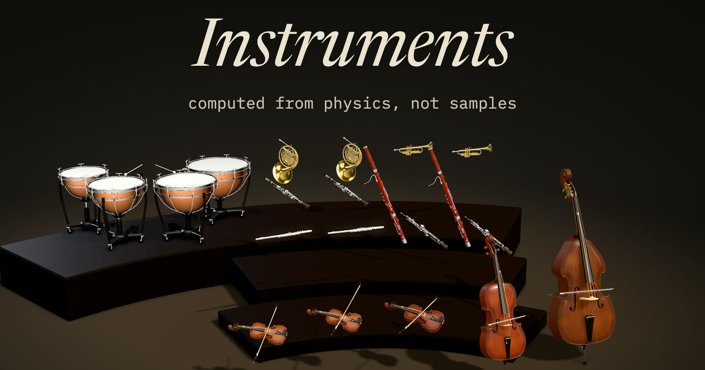

<p align="center">
  <a href="https://instruments-wustep.vercel.app/orchestra"></a>
</p>

# Instruments

Thirteen acoustic instruments, physically modelled and computed in real time in the
browser: a **piano**, a **violin**, a **viola**, a **cello**, a **double bass**, a
**flute**, an **oboe**, a **clarinet**, a **bassoon**, a **horn**, a **trumpet**, a
**trombone** (alto, tenor and bass) and the **timpani**. No samples are ever played as the sound. Every note is a simulation of
felt hammers, bows, air jets, reeds and lips driving strings and tubes, which in turn
drive a soundboard or body, or of felt mallets on the air-loaded membranes of kettledrums.

**Play it:** [https://instruments-wustep.vercel.app](https://instruments-wustep.vercel.app)

Each instrument has its own address
([piano](https://instruments-wustep.vercel.app/piano),
[violin](https://instruments-wustep.vercel.app/violin),
[viola](https://instruments-wustep.vercel.app/viola),
[cello](https://instruments-wustep.vercel.app/cello),
[double bass](https://instruments-wustep.vercel.app/bass),
[flute](https://instruments-wustep.vercel.app/flute),
[oboe](https://instruments-wustep.vercel.app/oboe),
[clarinet](https://instruments-wustep.vercel.app/clarinet),
[bassoon](https://instruments-wustep.vercel.app/bassoon),
[horn](https://instruments-wustep.vercel.app/horn),
[trumpet](https://instruments-wustep.vercel.app/trumpet),
[trombone](https://instruments-wustep.vercel.app/trombone),
[timpani](https://instruments-wustep.vercel.app/timpani)),
as do the [Orchestra](https://instruments-wustep.vercel.app/orchestra),
[Notes](https://instruments-wustep.vercel.app/notes) and
[Measurements](https://instruments-wustep.vercel.app/measurements).
`/french-horn`, `/kettledrums`, `/double-bass`, `/grand` and `/upright` open the same instruments.

`main` is the production deployment (`vercel.json`: `pnpm build` → `apps/web/dist`).

## Remix it

The code is MIT: fork it, take an instrument, build another. Everything is TypeScript in a pnpm
workspace, and nothing needs a server or a key.

**A slim clone.** The repository carries the before/after audio, spectrograms and screenshots of every
change under `artifacts/` (about 2,200 files, 415 MB): a record, which the app, the tests and the build
never read. A partial, sparse clone leaves them on the server: about 4 MB to download and 11 MB on disk
with the working tree, instead of about 400 MB.

```sh
git clone --filter=blob:none --sparse https://github.com/wustep/instruments.git
cd instruments
git sparse-checkout set --no-cone '/*' '!/artifacts/'
pnpm install
pnpm dev                      # http://localhost:5199
```

Install, typecheck, build and the unit tests all pass on it. `git sparse-checkout disable` fetches the
artifacts if you want them after all.

**Where things are.**

* `packages/engine`: the models. `src/core` is the DSP, one module per instrument family with its
  fitted voicing beside it, and no Web Audio in it, so the same code runs in the AudioWorklet and in
  Node (tests, calibration, offline renders). [Using the engine elsewhere](#using-the-engine-elsewhere)
  is a short example.
* `apps/web`: the page. `src/ui` draws each instrument in 2D twice (filled, and vector lines) and
  `src/ui/gl` in 3D; `src/orchestra` seats an ensemble and routes a MIDI file's parts to it.
* `scripts`: calibration against the recordings, the judge that decides whether a change is kept,
  renders, screenshots. `e2e`: Playwright. `docs`: research notes with citations, calibration
  rounds, performance.
* [`AGENTS.md`](AGENTS.md) is the map and the house rules, written for people and coding agents
  alike: the architecture, the commands, the gate before a merge, the checklist for a new
  instrument, and each rule with the test that enforces it.

**Places to start.** A fourteenth instrument (the checklist in `AGENTS.md`; the oboe, clarinet and
bassoon were each one pull request of the same shape). Your own piece: drop a MIDI file on the
Orchestra, and its address becomes a preset you can share. Another look for the stage:
`apps/web/src/ui/vector` is a second drawing of every instrument on the same data. A voicing you
disagree with: every fitted number is in a `*-tuning.json` or `*-fit.json` next to its model, and
`scripts/judge.ts` will tell you if yours is closer to the recordings.

## What you can do

* **Play.** Use the computer keyboard (`A`…`'`, with `Z`/`X` for octave and `C`/`V`
  for velocity), the on-screen keyboard (strike nearer the front of a key to play
  louder) or a MIDI keyboard. MIDI devices can be plugged in while the page is
  open. On a phone the keys carry no letters and stay a finger wide: a thin
  strip over them shows all 88 with a window on the ones in view, and dragging
  it slides the keys (a drag on the keys themselves is a glissando).
* **Controllers and pedals.**
  * **Sustain (CC64)** is continuous, so half-pedalling works.
  * **Una corda (CC67)** and **sostenuto (CC66)** apply to the piano.
  * **Vibrato (CC1)** and **expression (CC11 / CC2)** apply to strings and winds.
  * **A MIDI file's dynamics**: its volume (CC7) and expression (CC11) are a gain on the
    instrument playing each part (General MIDI's curve), its mod wheel (CC1) where it moves
    goes to the bowed and wind instruments. A part with none (one velocity, nothing that
    moves) is phrased automatically: phrase arches, swells on held notes (bow speed, force
    and vibrato, or breath), a little unevenness per part. The hairpin in the player turns
    that off. `apps/web/src/expression.ts`.
  * On the computer keyboard, hold `Space` for sustain and `Shift` for una corda.
* **The top panel.** The bar is what is on the stage and how it is seen: the instruments by family (one
  button and a sheet of all thirteen on a phone or a narrow window), the orchestra, the piano's kind, the
  view, the two pages. The band under it is what is sounding: the readout names every note (one note with
  its frequency; a few notes with the chord they make; many, counted with their span; an ensemble, how
  many of its parts), then the spectrum and one instrument's excitation or an ensemble's parts, each lit
  with its own notes. `apps/web/src/ui/readout.ts`, `apps/web/src/panel.css`.
* **Instruments.** Choose one with the picker in the bar. The piano has
  four presets: concert grand, upright, honky-tonk and prepared.
* **Vector lines.** “vector” in the bar's view switch (2d · vector · 3d) redraws the 2D stage as a vector
  display: thin glowing lines on black, the instrument in blue, the sound in amber, and
  each knob in a colour of its own that also marks what it moves on the drawing. The
  stage as it was stays the default; the choice is remembered, and `?view=vector` in
  the address sets it (`?style=vector` still does). After Jameson Hodge's Chimera vocal synth (see [Credits](#credits)); the drawing kit and
  the colour roles are in `apps/web/src/ui/vector/kit.ts`.
* **Ensemble.** “orchestra” at the end of the picker (four dots on an arc; a square button beside the
  instrument's on a phone) puts several instruments on
  the stage, each its own engine; tap an instrument to add one. Five or more sit as an
  orchestra (strings in front, first violins to the audience's left, woodwinds, then brass
  and timpani at the back, on risers); up to four keep a chamber arc. The keys (on the
  screen, the computer's, a plug-in MIDI keyboard with its pedals and wheels) play the
  instruments lit on the fallboard: the piano if there is one, else the highest melodic
  instrument, until you choose; tap to add or take one, so one key can sound on several.
  Split (the fork after them) deals a chord out by register instead, one note per
  instrument. `apps/web/src/orchestra/keys.ts`. Drop a MIDI file with several
  parts and each part gets an instrument by its name, General MIDI program and range;
  the row under the player shows each part's instrument (tap one to change or silence
  it). The list icon in the player, next to the folder, holds public-domain pieces from the Mutopia
  Project: Haydn's "Emperor" quartet (II), Brandenburg No. 5 (III), Handel's
  Réjouissance, Bach's Air for four trombones, and Beethoven's Fifth Symphony (I and II) on
  its eighteen instruments, each wind staff divided between its two players. Pieces and
  assignment: `apps/web/src/orchestra/`.
* **Addresses.** Every tab has its own address (`/violin`, `/piano/upright`, `/orchestra`,
  `/notes`…), so back and forward walk the tabs and a reload stays put. The Orchestra's
  address carries its whole setup, kept up to date as it changes: the instruments in
  their seats, which track goes where (by track name, then General MIDI program, then
  place, so it applies to a file dropped in later), what the keys play, 2D or 3D and the
  expression. There is nothing to press: the address is a preset. For example, a string
  quintet that plays a file with Violin I/II, Viola, Cello (or Violoncello) and Contrabass
  tracks:
  [https://instruments-wustep.vercel.app/orchestra?v=1&seats=violin,violin,viola,cello,bass&lines=Violin+I~40:1,Violin+II~40:2,Viola~41:3,Cello~42:4,Contrabass~43:5](https://instruments-wustep.vercel.app/orchestra?v=1&seats=violin,violin,viola,cello,bass&lines=Violin+I~40:1,Violin+II~40:2,Viola~41:3,Cello~42:4,Contrabass~43:5).
  The Daylight quintet itself is not bundled; that address is a preset you can drop the file onto.
  Beethoven's Fifth, seated and routed (its play icon plays the first movement; Mutopia's
  own files dropped on it play the same way, staff by staff):
  [https://instruments-wustep.vercel.app/orchestra?v=1&seats=flute,flute,oboe,oboe,clarinet,clarinet,bassoon,bassoon,horn,horn,trumpet,trumpet,timpani,violin,violin,viola,cello,bass&lines=one~73:1.2,two~68:3.4,three~71:5.6,four~70:7.8,five~69:9.10,six~69:11.12,seven~47:13,eight~40:14,nine~40:15,ten~41:16,eleven~42:17,twelve~43:18](https://instruments-wustep.vercel.app/orchestra?v=1&seats=flute,flute,oboe,oboe,clarinet,clarinet,bassoon,bassoon,horn,horn,trumpet,trumpet,timpani,violin,violin,viola,cello,bass&lines=one~73:1.2,two~68:3.4,three~71:5.6,four~70:7.8,five~69:9.10,six~69:11.12,seven~47:13,eight~40:14,nine~40:15,ten~41:16,eleven~42:17,twelve~43:18).
  Format: `apps/web/src/address.ts`; matching: `apps/web/src/orchestra/rules.ts`.
* **Look inside.** See what each instrument is doing as it plays:
  * the string displacement or bore pressure, live;
  * the hammer's contact force with its felt hysteresis loop, or the bow's
    stick–slip, or the flute's jet flow;
  * soundboard or body modes;
  * a spectrum with the predicted partials marked.

  Physical controls include:
  * piano: hammer hardness, string stiffness, unison detune, soundboard damping,
    string decay, lid and room;
  * strings: bow position, bow force, vibrato and body damping;
  * flute: breath pressure, lip-to-edge distance, noise and vibrato.
* **Measurements.** The piano is compared with a recorded Steinway model B on
  inharmonicity, stretch tuning, decay, spectra across dynamics, loudness and
  spectral balance. You can listen side by side; the model is rendered live in
  your browser. The violin, viola, cello and flute are compared with anechoic
  recordings of real ones (harmonic profiles, long-term spectra, even
  harmonics, noise, dynamics). A candid list of where it falls short is
  included.

## How it works, in plain words

* **Piano.**
  * **Strings.** Each string is a pair of travelling waves in a delay line. Stiff
    wire makes upper partials sharp, which is reproduced to within a fraction of a
    cent by an all-pass filter chain designed per key. Losses come from a fitted
    filter, and each string has a second, horizontally vibrating twin.
  * **Hammer.** A felt hammer whose spring stiffens as it is squashed is solved
    exactly each sample, so loud notes are brighter by physics rather than by
    filtering.
  * **Soundboard.** Two or three detuned strings per note, together with every
    undamped string on the instrument, share one bridge on a modal soundboard. The
    two-stage decay, beating and sympathetic resonance with the pedal down all
    come from that coupling.
  * **Dampers, pedals, noises.** Dampers press on gradually, so half-pedalling
    works. The top keys have no dampers, as on a real grand. Key thump and damper
    noise are small physical force pulses.
* **Violin, viola, cello, double bass.**
  * **Bowing.** The bow grips each string by friction (a stick–slip law) until it
    slips. Once per period it catches again, and the classic Helmholtz motion
    emerges without being programmed.
  * **Bow changes.** There is one bow, with a length. Each detached note goes
    the other way (down-bow, up-bow), and long notes change bow when the hair
    runs out. At the turn the bow slows through zero and the stick–slip
    re-forms in the opposite direction.
    When a file or a piece plays, the notes to come are known and the bow is
    planned ahead, as by a player reading the part: long notes drawn slower and
    nearer the bridge so one bow carries them, the stroke begun where it has
    room, the bow lifted to its next place in a rest. From the keys each note
    is met as it comes.
  * **Body.** Fingers shorten the strings, with vibrato. All four strings stand on
    one bridge over a modal body with each instrument's signature air and wood
    resonances, so open strings ring sympathetically. The double bass is the same
    physics at its own measures: a 3/4 bass tuned in fourths (E1–G4), its air
    mode near 60 Hz among its own fundamentals.
* **Flute.**
  * **Jet and tube.** A jet of breath is deflected by the sound in the tube. The
    time a ripple takes to travel along the jet decides which resonance it feeds.
  * **Overblowing.** Blowing harder makes the jet faster: the tone brightens,
    pitch rises slightly, and eventually the tube overblows to its octave, which
    is how the upper registers work.
  * **Tone.** The jet is aimed slightly off the edge, so it splits unevenly and
    makes even harmonics. Vortices shed at the edge limit the amplitude before
    the jet saturates, and both openings radiate as monopoles: the sound is the
    rate of change of their air flow.
* **Oboe.**
  * **Reed and cone.** Two cane blades blown closed let air into a conical bore,
    modelled as a cylinder open at both ends driven where the cone's missing tip
    would end (the "cylindrical saxophone"): every harmonic, overblowing at the
    octave. The reed's flow and the pressure in the staple are solved together
    every sample.
  * **Dynamics in the lips.** Oboists blow at nearly the same pressure soft or
    loud; a soft note closes the reed's opening, which lowers its closing pressure
    and with it the sound. Tonguing holds the blades shut while the breath builds.
  * **Compass.** B♭3–A6 at concert pitch (the oboe is in C); the keys in 2D and 3D
    follow the Woodwind Fingering Guide's standard fingerings.
* **Clarinet.**
  * **Reed and cylinder.** One cane reed beats against the mouthpiece's lay on a
    cylindrical bore, closed at the reed: a quarter-wave pipe, odd harmonics in the
    low register, overblowing at the twelfth. Above the open-hole lattice's cutoff
    (about 1.5 kHz) the bore barely resonates and every harmonic comes through.
  * **Compass.** D3–B♭6 at concert pitch (the B♭ clarinet, written E3–C7); the keys
    in 2D and 3D follow the Boehm system's standard fingerings.
* **Bassoon.**
  * **The oboe's bass.** The same double reed, larger, on a narrow cone 2.5 m long
    folded in two (bocal, wing joint, the boot's U-bend, long joint, bell): the
    oboe's two-tube bore with a long missing tip. Above the open-hole lattice's
    cutoff (about 400–500 Hz) the bore loses its resonances a few harmonics above
    the note, which gives the low notes their weak fundamental under a formant
    near 500 Hz and lets them settle as quickly as a played one.
  * **Compass.** B♭1–E5, in C (written as it sounds, bass and tenor clef); the keys
    in 2D and 3D follow the Heckel system's standard fingerings (the Woodwind
    Fingering Guide's chart).
* **Trumpet, horn, trombone.**
  * **Lips.** The player's lips are a small mass on a spring that the breath blows
    open and the mouthpiece's pressure pulls shut. They lock to a resonance of the
    bore just above their own; the valves or the slide set the tube's length and
    the lips' tension picks the partial, as on the real instruments.
  * **Trumpet.** A B♭ trumpet with its three valves' real fingerings; the bell
    reflects the lows back into the bore and lets the highs out.
  * **Horn.** The double horn in F and B♭ (3.7 m and 2.8 m of mostly conical tube,
    the thumb valve choosing), played high in its series, where neighbouring
    partials are a tone or less apart. B♭1–F5 at concert pitch.
  * **Trombone.** Built from its measures: the mouthpiece's cup and throat, two
    thirds of the tube a 13.9 mm cylinder that the slide lengthens, a Bessel-horn
    bell. Loud, the wave steepens along the cylinder towards a shock, computed in
    pascals: the brassy fortissimo. One model at three sizes (alto, tenor with
    its F valve, bass with F and G♭).
* **Timpani.**
  * **Heads.** Four pedal drums (32″ to 23″, C2–A3), each a Mylar membrane as 96
    of its modes. The air on both sides loads the low modes most, which pulls the
    modes with nodal diameters into the near-harmonic series a kettledrum's pitch
    is; the kettle's air stiffens the modes that pump it. Each mode loses what it
    radiates: the first thumps and dies, the principal tone rings for seconds.
  * **Mallet.** A mass on felt that stiffens as it is squeezed: a soft stroke is
    a long push that sounds the principal tone and little else, a loud one is
    short and hard, brings out the modes above and stretches the head, so the
    note starts a little sharp.
* **Where it runs.** Everything runs in an AudioWorklet written in TypeScript; no
  WASM was needed, as measured below. The DSP core has no Web Audio dependency,
  so the same code runs in Node for tests, calibration and offline rendering.

Details, design decisions and citations: [`docs/RESEARCH.md`](docs/RESEARCH.md).
Calibration rounds with numbers: [`docs/CALIBRATION.md`](docs/CALIBRATION.md).
CPU and latency: [`docs/PERFORMANCE.md`](docs/PERFORMANCE.md).

## Modelled vs approximated

| | modelled physically | approximated / not modelled |
|---|---|---|
| **Piano strings** | waveguides with per-key dispersion (stiffness), frequency-dependent loss, 1–3 detuned unisons, horizontal polarisation, stretch tuning from inharmonicity, preparations (point masses and dashpots) | longitudinal waves are a squared-force generator through two resonances, not a waveguide |
| **Hammer** | nonlinear Hunt–Crossley felt (power law + hysteresis), implicit Newton solve, una corda shift | no key-travel delay, no shank flexibility |
| **Soundboard** | ≈150-mode passive modal board at three bridge zones, coupled to every undamped string, giving sympathetic resonance | modes are plausible rather than measured; above ~3 kHz a smoothed path; the bass aftersound is still short |
| **Dampers / pedals** | continuous damper contact with half-pedal, undamped top keys, sostenuto, pitched damper noise | key and action noises are short synthetic pulses |
| **Bowed strings** | stick–slip friction with hysteresis, Helmholtz motion, bow position/force/speed (Schelleng), one shared bow with length, direction and automatic bow changes, stopped strings with vibrato, four strings on one bridge, modal body with A0/B1 modes, sympathetic open strings | torsional waves, bow width and the bridge hill on the cello only; body modes from the literature, their radiation **fitted to Iowa MIS recordings** (violin and viola note by note on held-out-checked halves, with the Helmholtz corner's brightness following the bow force), not measured |
| **Flute** | jet-drive feedback with jet delay from blowing pressure, overblowing, Strouhal-limited jet, offset jet (even harmonics), vortex-shedding amplitude limit, monopole radiation, turbulence noise, open–open bore; voicing **fitted to Iowa MIS recordings** | no tone holes or bore taper; low-register H2 at mf/ff still ~10 dB short of a real flute; per-note tuning uses a measured voicing table |
| **Oboe** | double reed blown closed (quasi-static Bernoulli flow, closing at pM), conical bore as two waveguides meeting at the reed (cylindrical saxophone), dynamics through the reed's opening (lips), tonguing, turbulence noise; voicing and radiation **fitted to Iowa MIS recordings** | no tone holes, octave vents or reed resonance; each note is played on the tube whose fundamental it is; low notes at ff speak slowly (the fundamental takes over from the 4th–6th harmonics in about 0.3 s); per-note tuning uses a measured voicing table |
| **Bassoon** | the oboe's double reed and two-tube conical bore with a long missing apex (0.14 m), walls losing more a few octaves above the note, dynamics through the reed's opening, tonguing, turbulence noise; voicing and radiation (its fixed formant near 480 Hz) **fitted to Iowa MIS recordings** | no tone holes, half-hole, flick or whisper key (each note on the tube whose fundamental it is); C♯3–D♯3 at mf/ff radiate their odd harmonics weakly (heard leaning to the octave); per-note tuning uses a measured voicing table |
| **Clarinet** | single reed against the lay (quasi-static flow, solved with the bore each sample) on a cylinder closed at the reed: odd harmonics low, the twelfth above; the open-hole lattice's cutoff near 1.5 kHz, wall loss, tonguing, turbulence noise; voicing and radiation **fitted to Iowa MIS recordings** | no tone holes, register key or altissimo vents (each note on the tube whose fundamental it is); the reed's own resonance is left out; per-note tuning uses a measured voicing table |
| **Trumpet** | lips as a mass–spring valve, flow growing with the square of the opening (louder is brighter), a bore whose length the three valves set, the partial chosen by lip tension, a bell that radiates ∝ f² below its cutoff, turbulence at the lips; **fitted to the Iowa trumpet** | the bore is one delay loop, not the trumpet's measured profile; no mouthpiece cup, no mutes; per-note tuning uses a measured table |
| **Horn** | outward-striking lip valve (Bernoulli flow, solved in closed form each sample) on a conical bore as two waveguides, F and B♭ sides with the players' fingering, the wave's steepening when loud; colour (the hand in the bell, the bell turned away) **fitted to the Iowa horn** | the hand is a fitted colour, not a moving obstacle: no stopped or muted notes; the reference set has gaps (no pp C2–B3, no mf C3–B3) |
| **Trombone** | the same lips in SI units, a cup-and-throat mouthpiece, a lossy cylinder the slide lengthens, a Bessel-horn bell of scattering sections, nonlinear steepening from the air's own constants, slide glissando and legato tongue; three sizes; **fitted to the Iowa tenor and bass trombones** | no mutes; the slide is placed by ear (so the chosen resonance is the note), not by a ruler; the alto has no recording of its own |
| **Timpani** | air-loaded membrane modes (96 per drum), the kettle's air as a spring on the symmetric modes, each mode's radiation loss from its own far field, tension rising with the stroke, a felt mallet with hysteresis that bottoms out, rolls, pedals; voicing **fitted to the VSCO 2 CE timpani** | the kettle's own air resonances (above about 300 Hz) are left out; modes above the 96 are a band of noise; the added mass's scale and the floor of the losses are fitted |
| **Listener** | close "microphones" from mode shapes | lid shelf, small FDN room, safety limiter (audio effects, not physics) |

## Realism, candidly

* **Piano.** Against a Steinway B recording (round 2, `docs/CALIBRATION.md`):
  * stretch tuning is within ≈ 4 ¢ RMS and inharmonicity within ≈ 17 % RMS;
  * prompt decay is within ×0.90–1.14 of the recording in every register, and the aftersound within ×0.95–1.11 above B1;
  * the spectral balance is within ≈ 4.6 dB per third-octave band;
  * loudness is within ≈ 5–8 dB per note;
  * the pp→ff brightening is within 0.4 dB per partial (median).

  The biggest remaining audible gap: the lowest octave's aftersound is about
  two-thirds as long as the recording's.

  It sounds like a convincing grand: closer than classic synthesis, short of a
  high-end commercial modelled piano.
* **Strings.** Against anechoic Iowa MIS recordings (333 notes with the flute;
  round-1 → round-2 numbers in `docs/CALIBRATION.md`):
  * third-octave spectral error: violin 17.5 → 14.6 dB, viola 14.2 → 11.0 dB,
    cello 20.8 → 17.0 dB;
  * the pp→ff level spread is now close to the recordings'.

  They have genuine bowed attacks, bow changes, transients and
  pressure/position response, and play louder the way players do: closer to
  the bridge. The biggest gaps:
  * above about 4 kHz the modelled bodies still radiate far less than the real
    instruments;
  * the cello is a few dB noisier between harmonics than its recording.
* **Flute.** Even harmonics, breath noise, dynamics and register balance are
  fitted to the Iowa flute:
  * the spectral error went from 8.2 to 4.5 dB;
  * the even/odd balance error by register went from −26 / −16 / −4 dB to
    −9 / −3 / −3 dB.

  The low register at mf/ff is still about 10 dB short of a real flute's
  second harmonic, and notes speak a little slowly.
* **The rest of the orchestra.** Each was fitted to its Iowa recordings with a
  judge on held-out notes (a change is kept only if the notes it was not fitted
  to say BETTER). Third-octave spectral error now: double bass 4.9 dB, oboe 10.5,
  clarinet 4.0, bassoon 8.7, horn 14.4, trumpet 3.3, trombones 5.5; pitch within
  0.2–3 ¢ RMS. The timpani, against the VSCO 2 CE drums in a room: partials within
  31 ¢, their levels within 8 dB, the principal tone's decay matched. The whole
  table is on the [Notes](https://instruments-wustep.vercel.app/notes) page, and the
  histories are in `docs/ensemble-rounds.json` and `artifacts/round3/`.

## Run, test, render

```sh
pnpm install
pnpm dev                      # http://localhost:5199
pnpm build && pnpm preview    # static build in apps/web/dist (Vercel: vercel.json)

pnpm test                     # unit tests (vitest)
pnpm e2e                      # builds, then Playwright: desktop + phone in installed Chrome, a smoke test in WebKit (npx playwright install webkit)
pnpm bench                    # CPU per voice / instrument

pnpm refs:fetch               # download Iowa reference notes into .cache/ (gitignored, ~650 MB)
pnpm calibrate [--fit] [--decay-only]   # measure (and fit) the piano against them
pnpm refs:ensemble            # download + segment Iowa violin/viola/cello/flute runs (.cache/iowa-ens, ~500 MB)
pnpm calibrate:ensemble       # strings and flute vs those recordings [--engine <other checkout> for baselines]
npx tsx scripts/fit-flute.ts  # fit the flute voicing; scripts/fit-strings.ts <violin|viola|cello> for the bodies
npx tsx scripts/fit-oboe.ts   # fit the oboe voicing (fit half), then scripts/tune-oboe.ts; scripts/oboe-regimes.ts surveys its registers
npx tsx scripts/fit-clarinet.ts   # the clarinet's, the same way (tune-clarinet.ts, clarinet-regimes.ts, render-clarinet.ts)
npx tsx scripts/fit-bassoon.ts    # the bassoon's, the same way (tune-bassoon.ts, bassoon-regimes.ts, render-bassoon.ts)
npx tsx scripts/fit-horn.ts       # the horn's, the same way (tune-horn.ts, horn-regimes.ts: every note on its partial, render-horn.ts)
npx tsx scripts/fit-trombone.ts   # the trombone's: the Iowa tenor and bass trombones, three sizes (tune-trombone.ts, trombone-regimes.ts, trombone-grid.ts, render-trombone.ts)
npx tsx scripts/timpani-refs.ts   # the VSCO 2 CE timpani (CC0; .cache/vsco-timpani), analysed as struck strokes
npx tsx scripts/fit-timpani.ts    # the timpani's voicing on drums 1, 3, 5 (polish-timpani.ts, tune-timpani.ts, calibrate-timpani.ts --write, render-timpani.ts)
npx tsx scripts/judge.ts --instrument <id> --before <an older checkout's engine>   # BETTER / WORSE / NO CLEAR CHANGE on held-out notes
node scripts/icons.mjs            # favicon.ico and apple-touch-icon.png from apps/web/public/favicon.svg
```

Every audible change to an engine ships its before/after MP3s, spectrograms and numbers under
`artifacts/round3/<topic>/` (see `AGENTS.md`); `artifacts/README.md` and `artifacts/round2/README.md`
describe the first two rounds.

## Using the engine elsewhere

`packages/engine` is a self-contained package:

```ts
import { createInstrument } from '@piano-model/engine';
const inst = await createInstrument(audioContext, { instrument: 'piano', preset: 'grand' });
inst.connect(audioContext.destination);
inst.noteOn(60, 90); inst.sustain(0.5); inst.noteOff(60);
await inst.setInstrument('cello');
inst.control(11, 0.8);                       // expression
```

* **Offline rendering.** In the browser use `renderOffline({ events, duration, instrument })`,
  which goes through the real AudioWorklet. In Node use `renderInstrument` or
  `renderCore` from `@piano-model/engine/core`.
* **Bundling.** The worklet module is bundled via Vite's `?worker&url`. Other
  bundlers can pass `processorUrl`.

## Limits

* **One of each.** Every instrument is compared with one recorded instrument and
  one player: a Steinway B (every 4th key, three dynamics), and the Iowa strings,
  woodwinds and brass at pp, mf and ff in an anechoic room (the strings in first
  position only). What is fitted is radiation, dynamics and voicing; bodies,
  bores and bells are taken from the literature, not measured. Single-note decay
  comparisons are dominated by the recorded piano's own idiosyncrasies, so
  register medians are reported.
* **Bowed strings.** Above about 4 kHz the modelled bodies still radiate far less
  than the real instruments. The bow touches the string at a whole-sample tap, so
  a small change of bow position can move a note's level by a dB or two.
* **Woodwinds.** None has tone holes: each note is played on the tube whose
  fundamental it is, tuned by a measured table, so there are no cross-fingerings,
  register keys or multiphonics. The flute's low register is short of second
  harmonic and it speaks a little slowly; the oboe's low notes at ff speak slowly;
  the bassoon's C♯3–D♯3 lean to the octave.
* **Brass.** No mutes and no stopped horn. The trumpet's bore is a single loop
  rather than its measured profile. The Iowa horn set has gaps the fit could not
  see into, and the alto trombone has no recording of its own.
* **Timpani.** Iowa has no timpani: the reference is one set of five drums
  recorded in a room (VSCO 2 CE, 24 strokes), not an anechoic one.
* **Orchestra.** A seat is one player on one engine, so a section is as many
  instruments as it has seats (twenty-four at most, fewer where the audio thread
  could not keep up), not the blend of a real section's many. Levels between
  instruments follow their recordings, not a conductor.
* **Phones and browsers.** On phones the worklet sheds sympathetic strings and
  polyphony under load, and the 3D stage draws a lighter scene. Sound needs an
  AudioWorklet (Safari 14.1 or later); 3D needs WebGL2.

## Credits

Built by [Stephen Wu](https://wustep.me) ([@wustep](https://x.com/wustep)) with Claude Opus 5.5 and
Claude Fable 5.2, Anthropic's models, working in Claude Code.

* **Reference recordings:** the [University of Iowa Musical Instrument
  Samples](https://theremin.music.uiowa.edu/MIS.html): a Steinway model B (2001), violin, viola (1996),
  cello (2001), double bass, flute (2000), oboe, B♭ clarinet, bassoon, horn (1997), trumpet, and tenor
  and bass trombones (1997). They are used for analysis only, never played as an instrument and never
  committed. The six short labelled excerpts on the Measurements page are used under the MIS terms
  ("used for any projects, without restrictions").
* **Timpani recordings:** the [VSCO 2 Community Edition](https://github.com/sgossner/VSCO-2-CE) by
  Versilian Studios (Sam Gossner and Simon Dalzell), CC0. Analysis only, as above.
* **Pieces:** the [Mutopia Project](https://www.mutopiaproject.org)'s typesettings of Bach, Handel,
  Haydn, Mozart, Beethoven, Chopin and a ground from Playford's Division Violin, played unchanged; each
  file's typesetter, source and sha256 are in `apps/web/src/orchestra/pieces.ts` and on the Notes page.
* **3D:** [three.js](https://threejs.org) (MIT).
* **The vector view** is after [Chimera](https://github.com/jamesondh/chimera-vocal-synth), Jameson
  Hodge's vocal synth: its screens were the inspiration, and none of its code is used. Its type is
  AVHershey Simplex by Stewart C. Russell, from A. V. Hershey's vector fonts (US Naval Weapons
  Laboratory, 1967).
* **Fonts:** Newsreader, IBM Plex Sans and IBM Plex Mono (SIL OFL), self-hosted.
* **The physics** is other people's, cited where it is used: `docs/RESEARCH.md`, the comments in
  `packages/engine/src/core`, and the Sources at the foot of the Notes page.

## License

The code is under the [MIT License](LICENSE). Bundled third-party files keep
their own terms and are not relicensed:

* **Pieces** (`apps/web/public/pieces/*.mid`): Mutopia Project files, public
  domain, except `bach-bwv1046-adagio-oboe.mid` (typeset by Ben Stewart,
  Mutopia-2008/10/29-1577), which is Creative Commons Attribution 3.0. Each
  file's source and credit is in `apps/web/src/orchestra/pieces.ts`.
* **Reference excerpts** (`apps/web/public/ref/*.mp3`): University of Iowa MIS,
  see `apps/web/public/ref/LICENSE.txt`.
* **Fonts:** AVHershey Simplex by Stewart C. Russell (CC0 / WTFPL); Newsreader
  and IBM Plex (SIL OFL).
