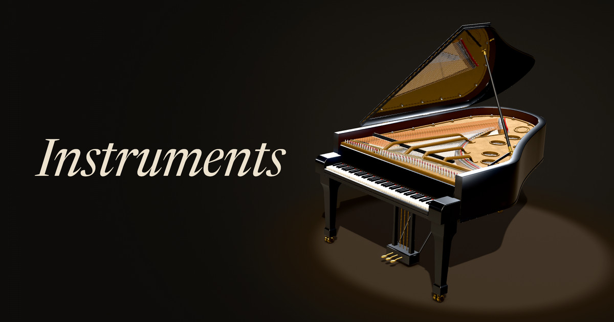

<p align="center">
  <a href="https://instruments-wustep.vercel.app/piano?view=3d"></a>
</p>

# Instruments

Sixteen acoustic instruments, each simulated as physics in real time in the browser. No samples are
played. Every note comes from a model of hammers, bows, fingers, air jets, reeds, lips or mallets driving
strings, tubes, membranes and bars.

**Play it:** [instruments-wustep.vercel.app](https://instruments-wustep.vercel.app).
**Hear the orchestra:** [/symphony](https://instruments-wustep.vercel.app/symphony) (*Toward Morning*, thirteen
seats), [/everything](https://instruments-wustep.vercel.app/everything) (*Everything So Far*, eleven) or
[/passiton](https://instruments-wustep.vercel.app/passiton) (*Pass It On*, all sixteen instruments on seventeen
seats). Each opens with its piece loaded and silent. Press play.

## Instruments

Each has its own address:

| Family | Instruments |
|---|---|
| Keys, plucked and struck | [piano](https://instruments-wustep.vercel.app/piano) (grand, and [upright](https://instruments-wustep.vercel.app/piano/upright)), [harp](https://instruments-wustep.vercel.app/harp), [timpani](https://instruments-wustep.vercel.app/timpani), [glockenspiel](https://instruments-wustep.vercel.app/glockenspiel) |
| Strings | [violin](https://instruments-wustep.vercel.app/violin), [viola](https://instruments-wustep.vercel.app/viola), [cello](https://instruments-wustep.vercel.app/cello), [double bass](https://instruments-wustep.vercel.app/bass) |
| Woodwinds | [flute](https://instruments-wustep.vercel.app/flute), [oboe](https://instruments-wustep.vercel.app/oboe), [clarinet](https://instruments-wustep.vercel.app/clarinet), [bassoon](https://instruments-wustep.vercel.app/bassoon) |
| Brass | [horn](https://instruments-wustep.vercel.app/horn), [trumpet](https://instruments-wustep.vercel.app/trumpet), [trombone](https://instruments-wustep.vercel.app/trombone) (alto, tenor and bass), [tuba](https://instruments-wustep.vercel.app/tuba) |

These aliases work too: `/grand`, `/upright`, `/double-bass`, `/contrabass`, `/french-horn`, `/kettledrums`
and `/glock`. The list of instruments is `INSTRUMENT_IDS` in `packages/engine/src/core/instrument.ts`.

## Pieces

Every bundled piece is public domain, apart from one Creative Commons file (see [License](#license)). The
pieces menu loads a piece and seats the orchestra it needs:

| Piece | Seats |
|---|---|
| Haydn, *Emperor* Quartet, Op. 76 No. 3, II | 4: two violins, viola, cello |
| Bach, Brandenburg Concerto No. 5, BWV 1050, III | 6: flute, two violins, viola, cello, grand piano (for the harpsichord) |
| Handel, *La Réjouissance*, from the Music for the Royal Fireworks, HWV 351 | 2: trumpet, grand piano (for the organ) |
| Bach, Air from the Orchestral Suite No. 3, BWV 1068, for four trombones | 4: alto, two tenor and bass trombones |
| Beethoven, Symphony No. 5, Op. 67, I | 18: two each of flutes, oboes, clarinets, bassoons, horns and trumpets, timpani, two violins, viola, cello, double bass |
| Beethoven, Symphony No. 5, Op. 67, II | 18: the same |
| Fable 5.2, *Toward Morning* ([/symphony](https://instruments-wustep.vercel.app/symphony)) | 13: flute, oboe, clarinet, bassoon, horn, trumpet, trombone, timpani, two violins, viola, cello, double bass |
| Fable 5.2, *Everything So Far* ([/everything](https://instruments-wustep.vercel.app/everything)) | 11: flute, clarinet, horn, glockenspiel, harp, grand piano, two violins, viola, cello, double bass |
| Fable 5.2, *Pass It On* ([/passiton](https://instruments-wustep.vercel.app/passiton)) | 17: all sixteen instruments, with two violins |

When nothing is loaded, the play button plays the instrument's own short piece:

* **piano:** Chopin, Prelude in C minor, Op. 28 No. 20
* **violin:** *Greensleeves to a Ground*, from Playford's *The Division Violin*
* **viola:** Bach, Cello Suite No. 1, BWV 1007, Menuet I (an octave up, as violists play it)
* **cello:** Bach, Cello Suite No. 1, Prélude
* **double bass:** Bach, Cello Suite No. 1, Menuet II
* **harp:** Bach, Cello Suite No. 1, Prélude (an octave above the cello)
* **flute:** Bach, Partita in A minor, BWV 1013, Bourrée anglaise
* **oboe:** Bach, Brandenburg Concerto No. 1, BWV 1046, Adagio (the oboe's line)
* **clarinet:** Mozart, Clarinet Quintet, K. 581, Larghetto (the clarinet's line)
* **bassoon:** Mozart, Bassoon Concerto, K. 191, Andante ma adagio (the bassoon's line)
* **horn:** Beethoven, Horn Sonata, Op. 17, Allegro moderato (the horn's line)
* **trumpet:** Handel, *La Réjouissance* (the trumpet's line)
* **trombone:** Bach, Air (the alto's line, on the tenor)
* **tuba:** Bach, Air (the bass trombone's line, an octave down)
* **timpani:** Mozart, Requiem, K. 626, Dies irae (the timpani's line)
* **glockenspiel:** Bach, Bourrée anglaise (a twelfth above the flute)

In an orchestra with nothing loaded, the play button plays the bundled piece that best fits the seats. Each
piece's file, source, credit and sha256 are listed in `apps/web/src/orchestra/pieces.ts`, and on the Notes
page.

## Playing

* **Three views** of every instrument: the filled 2D drawing, a vector-line 2D style (after Chimera; see
  [Credits](#credits)) and a WebGL2 3D stage (drag to turn, pinch or scroll to zoom). Without WebGL2 there
  is no 3D button.
* **On-screen keys.** On a phone or tablet, slide the strip above the keys to move along them. Dragging
  across the keys plays a glissando.
* **Computer keyboard.** `A S D F G H J K L ; '` are the white keys from C, and `W E T Y U O P` are the
  black keys. `Z`/`X` (or `-`/`=`) move an octave and `C`/`V` change velocity. `Space` is the sustain pedal,
  `Shift` the soft pedal and `B` the middle pedal (sostenuto on a grand, the muffler on an upright). `I`
  hides the 3D piano's case.
* **MIDI keyboard** (Web MIDI, hot-plugged). CC64 is sustain (continuous, so half-pedalling works), CC66
  sostenuto and CC67 una corda. CC1, CC2 and CC11 set bow pressure or breath. Pitch bend has a ±2 semitone
  range. Channel aftertouch controls vibrato depth, or makes the timpani and the glockenspiel roll.
* **MIDI files.** Drop a `.mid` anywhere, or open one from the player (on a phone, open is the only way in).
  A single-part file plays on the instrument shown. A file with several parts puts an orchestra on the
  stage. Files without their own dynamics are phrased automatically, and a file typed with every line on
  the grid has each line played slightly ahead of or behind the beat, as an ensemble plays (the hairpin
  button turns both off).
* **Each instrument's controls** are on the stage: hammer hardness and string stiffness on the piano, bow
  position and force on the strings, breath and embouchure or lips on the winds and brass, pluck point on
  the harp, mallets on the timpani and glockenspiel, and so on. Two rotary knobs set the piano's lid and the room. The 3D lid rests
  shut, on its short stick or on its long one.
* **Look inside.** A readout names every note sounding (one note with its frequency, a few by name with
  their chord, more as a chord or a count). Beside it are the spectrum and a trace of the excitation (the
  hammer's force, the bow, the jet, the reed, the lips, the mallet). On the piano, clicking a note's strings
  opens that key's action close-up, replayed in slow motion.
* **[Measurements](https://instruments-wustep.vercel.app/measurements)** sets each model beside its
  reference recordings, with a few Steinway excerpts to compare by ear. **[Notes](https://instruments-wustep.vercel.app/notes)**
  explains the physics and lists the sources.

## The Orchestra

[/orchestra](https://instruments-wustep.vercel.app/orchestra) puts several instruments on one stage, each
running its own engine.

* **Seats.** Pick up to eight instruments by hand (six on a phone). A piece or an address can seat more, as
  far as the audio thread can carry them (Beethoven's Fifth seats eighteen), up to 24. Up to four players
  sit on one arc. Five or more sit as an orchestra: strings in front with the first violins on the
  audience's left, woodwinds behind, brass at the back, each row behind the strings on a higher riser.
  Each part is heard from its seat.
* **Routing.** Each line of a file goes to an instrument by its track name, then its General MIDI program,
  then its place or range. A part named for its key ("Horn in F", "Clarinetto in A") and typed at written
  pitch is moved to concert pitch. Tap a line to move it or to silence it. The routing grid can put one line
  on several instruments, or several lines on one.
* **Players.** Every instrument but the piano has a player in its engine, measured on the recorded
  players, so no two notes are alike. The bows are planned ahead from the notes to come,
  sharing quick notes and lifting off the string in rests. Each wind or brass part is one player who slurs,
  tongues and breathes. The piano's player is the velocities and timing it is sent.

## Addresses

The address always describes the page, so it can be shared:

* `?view=2d|vector|3d` sets the view on any address.
* The Orchestra writes its whole setup into the query, versioned: `/orchestra?v=1&seats=violin,violin,viola,cello&lines=…&keys=…&expr=on|off`.
* A piece's own address (`/symphony`, `/everything`, `/passiton`) stays in the bar until the orchestra is
  rearranged. After that the address becomes the Orchestra's.
* For filming, `keys=0` hides the keys and `ui=0` shows the stage alone (a 2D piano keeps its keys; `keys=1` keeps them on any one instrument).
* `?debug` shows the start-up log.
* Any other path gets a 404 page that links every instrument, the Orchestra, the three pieces and the two
  pages.

## How it works

* **Models, by family** (`packages/engine/src/core`: one module per family, with its fitted voicing in a
  `*.json` beside it):
  * **piano:** waveguide strings, stiff and detuned in their unisons, struck by nonlinear felt hammers,
    with dampers and three pedals, all coupled through one bridge to a modal soundboard. Grand and upright
    are the same model at different measures.
  * **bowed strings:** stick–slip friction (McIntyre, Schumacher & Woodhouse), from which Helmholtz motion
    emerges rather than being imposed. Four waveguide strings meet on one bridge over a modal body.
  * **harp:** 47 strings as their partials, each swinging in two planes, seven pedals that set the scale,
    and a finger that plucks.
  * **flute:** an air jet driving a waveguide bore, so blowing harder overblows to the next register.
  * **oboe, clarinet, bassoon:** a reed's valve flow solved each sample against a conical bore (oboe,
    bassoon) or a cylindrical one (clarinet).
  * **brass:** lips as a mass–spring valve on a bore that the valves or the slide lengthen. The horn and
    the tuba share a conical bore whose wave steepens when played loud. The trombone is built from its own
    measures, with a cup mouthpiece and a Bessel bell.
  * **timpani:** four air-loaded membranes, their modes struck by a felt mallet.
  * **glockenspiel:** thirty steel bars, each with its pitch and five families of partials regressed from
    recordings, struck by two mallets.

  Each model is fitted to the University of Iowa MIS recordings, except the timpani (VSCO 2 CE) and the
  harp (VSCO 2 CE, then VCSL). Every change is judged on notes held out of the fit (`scripts/judge.ts`)
  and kept on a verdict of better. The harp is the exception: the judge cannot tell its fitted voicing
  from the hand-set one (no clear change), and its numbers say so. The players (`human`) are measured on
  the same recordings. At `human` 0 each engine is bit for bit the model that is fitted and judged. Citations are in [`docs/RESEARCH.md`](docs/RESEARCH.md), and the numbers
  in [`docs/CALIBRATION.md`](docs/CALIBRATION.md).
* **Engine.** The core has no Web Audio dependency, so the same TypeScript runs in an AudioWorklet
  (`src/worklet`, which parses in Safari 14.1 and later) and in Node for tests, calibration and offline
  renders. Cores render their own blocks, so the host's block size never changes the sound. The page talks
  to the engine through `src/api` (`createInstrument`, `createPiano`, `renderOffline`).
* **Renderers** (`apps/web/src/ui`): a 2D drawer per instrument in `ui/`, the vector style in
  `ui/vector/`, and the three.js 3D stage in `ui/gl/`, with a module per instrument and `fit3d.ts` framing
  the stage on phones. All three draw the same telemetry from the worklet. Seating, routing and the bundled
  pieces live in `apps/web/src/orchestra/`.

[`AGENTS.md`](AGENTS.md) is the full map, with the house rules (each with the check that enforces it) and
the checklist for a new instrument.

## Development

Node with pnpm 10:

```sh
pnpm install
pnpm dev          # Vite dev server, http://localhost:5199
pnpm typecheck    # engine and web
pnpm build        # apps/web/dist, then the Safari 14.1 worklet syntax check
pnpm preview      # serve the build (port 4199)
pnpm test         # Vitest unit tests
pnpm e2e          # build, then Playwright (Chrome desktop and Pixel 7, a WebKit smoke test)
pnpm bench        # the piano's CPU cost per voice
```

`artifacts/` holds about 520 MB of before/after audio and screenshots. Nothing builds from it. To skip it:

```sh
git clone --filter=blob:none --sparse https://github.com/wustep/instruments.git
cd instruments && git sparse-checkout set --no-cone '/*' '!/artifacts/'
```

Calibration needs the reference recordings in `.cache/`, which are never committed. Fetch and fit them with
`pnpm refs:fetch`, `pnpm calibrate`, `pnpm refs:ensemble`, `pnpm calibrate:ensemble`, and the per-instrument
`scripts/fit-*.ts`.

## Credits

Built by [Stephen Wu](https://wustep.me) ([@wustep](https://x.com/wustep)) with Claude Opus 5.5 and
Claude Fable 5.2, Anthropic's models, working in Claude Code.

* **Reference recordings:** the [University of Iowa Musical Instrument
  Samples](https://theremin.music.uiowa.edu/MIS.html): a Steinway model B, violin, viola, cello, double
  bass, flute, oboe, B♭ clarinet, bassoon, horn, trumpet, tenor and bass trombones, tuba and orchestra
  bells. They are used for analysis only and never played as an instrument. Six short Steinway excerpts
  on the Measurements page are used under the MIS terms.
* **Harp and timpani recordings:** the [VSCO 2 Community Edition](https://github.com/sgossner/VSCO-2-CE)
  by Versilian Studios, CC0, and, for the harp's two dynamics, their [Versilian Community Sample
  Library](https://github.com/sgossner/VCSL), CC0. Analysis only.
* **Pieces:** the [Mutopia Project](https://www.mutopiaproject.org)'s typesettings of Bach, Handel, Haydn,
  Mozart, Beethoven, Chopin, and a ground from Playford's *The Division Violin*. The files are bundled
  byte for byte. What a player would change (which lines play, a transposition, a tempo) is set beside
  them in `pieces.ts`. *Toward Morning*, *Everything So Far* and *Pass It On* were written for these
  instruments by Fable 5.2 (2026).
* **3D:** [three.js](https://threejs.org) (MIT).
* **The vector view** is after [Chimera](https://github.com/jamesondh/chimera-vocal-synth), Jameson
  Hodge's vocal synth. Its screens were the inspiration; none of its code is used. The vector type is
  AVHershey Simplex by Stewart C. Russell, from A. V. Hershey's vector fonts (US Naval Weapons
  Laboratory, 1967).
* **Fonts:** Newsreader, IBM Plex Sans and IBM Plex Mono (SIL OFL), self-hosted.
* **The physics** is other people's, cited where it is used: in `docs/RESEARCH.md`, in the comments in
  `packages/engine/src/core`, and in the Sources on the Notes page.

## License

The code is under the [MIT License](LICENSE). Bundled third-party files keep their own terms:

* **Pieces** (`apps/web/public/pieces/*.mid`): Mutopia Project files, public domain, except
  `bach-bwv1046-adagio-oboe.mid` (typeset by Ben Stewart, Mutopia-2008/10/29-1577), which is under Creative
  Commons Attribution 3.0.
* **Toward Morning** (`apps/web/public/pieces/fable-toward-morning.mid`), **Everything So Far**
  (`apps/web/public/pieces/fable-everything-so-far.mid`) and **Pass It On**
  (`apps/web/public/pieces/fable-pass-it-on.mid`), this project's own pieces, are dedicated to the public
  domain under [CC0 1.0](https://creativecommons.org/publicdomain/zero/1.0/).
* **Reference excerpts** (`apps/web/public/ref/*.mp3`): University of Iowa MIS; see
  `apps/web/public/ref/LICENSE.txt`.
* **Fonts:** AVHershey Simplex (CC0 / WTFPL); Newsreader and IBM Plex (SIL OFL).
