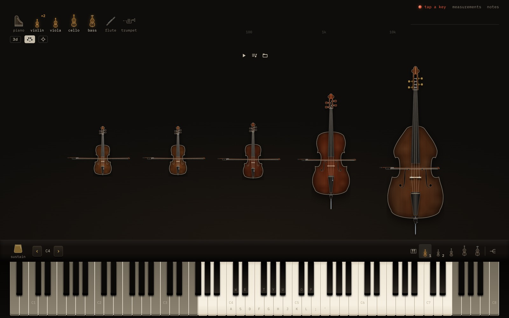
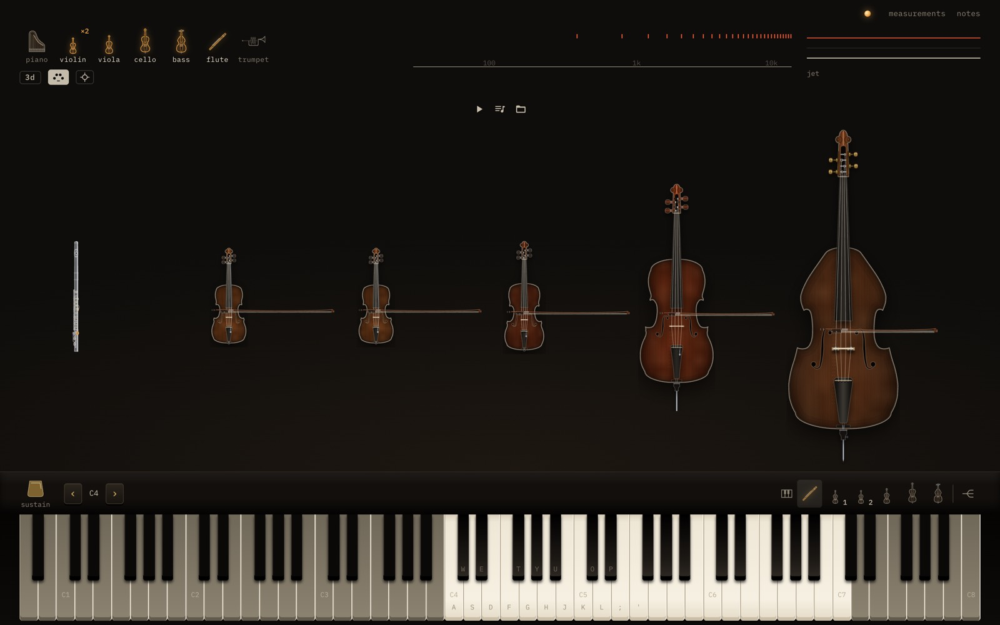
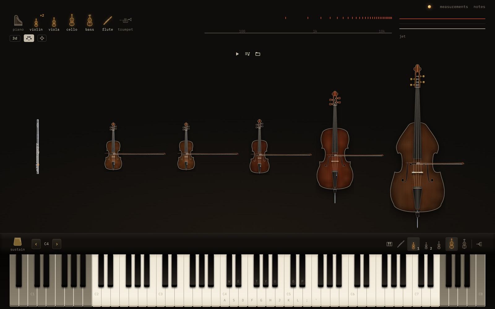
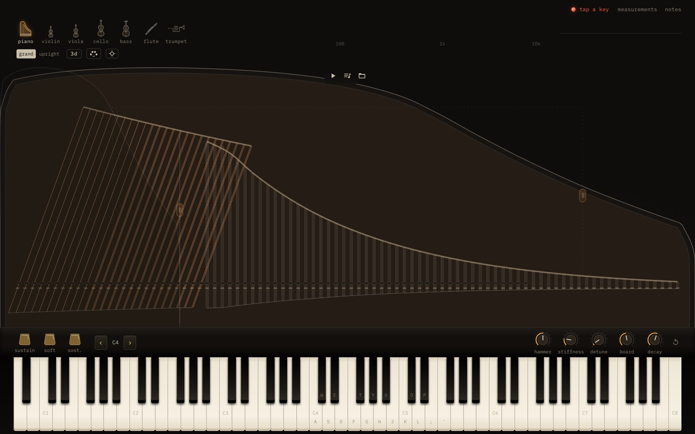
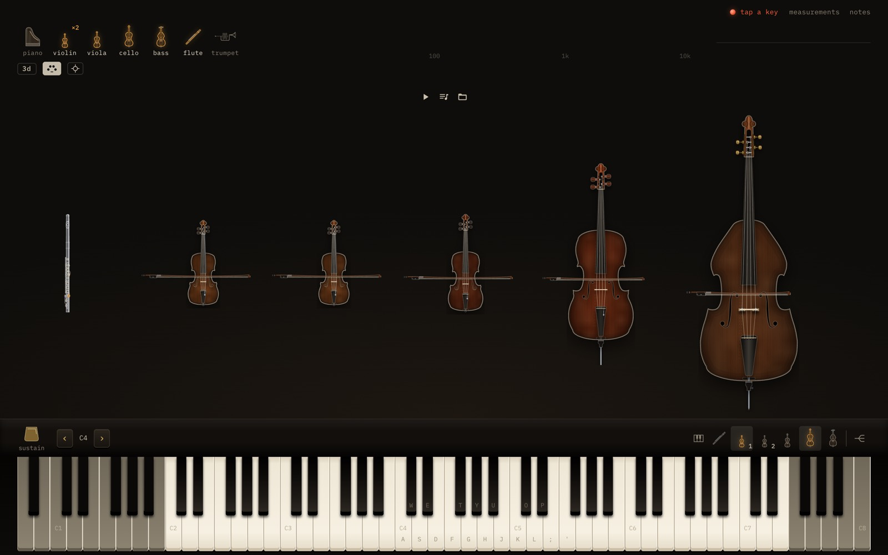

# The Orchestra's setup in the address, and a string quintet preset

Brief: `.autopilot/briefs/ORCH-URL.md`. Stephen: "add a feature that saves the orchestra setup to
the URL and then link me a preset template", "(it should just be automatic, no button required)",
"yep and generally clicking the tabs should change the url too".

## The preset

**https://instruments-wustep.vercel.app/orchestra?v=1&seats=violin,violin,viola,cello,bass&lines=Violin+I~40:1,Violin+II~40:2,Viola~41:3,Cello~42:4,Contrabass~43:5**

Open it, drop `Max Richter - On the Nature of Daylight (String Quintet).mid`, and it plays. Violin I
goes to the first violin, Violin II to the second, Viola to the viola, Violoncello to the cello
(the preset says "Cello"; the two names match), and Contrabass to the double bass. The look (2D or
3D) and the automatic expression are left out on purpose, so they stay as your device has them.
Once the page is open, its address adds `&view=…&expr=…`.

## What it did before

The app was hash-routed: `#/`, `#/measurements` and `#/notes` existed, and `?style=vector`. The
instrument, the piano's kind and the Orchestra were not in the address. A reload dropped the
ensemble: you got the single instrument back. There was no `/orchestra` page, so production
answered the preset address with a Vercel 404.

| | before (production, `cbab859`) | after |
|---|---|---|
| the preset address |  404 NOT_FOUND |  the quintet, from the address alone, no sound started until a gesture |
| a setup made by hand (flute + quintet, the keys on violin 1 and the cello) |  address `/` |  `/orchestra?v=1&seats=flute,violin,violin,viola,cello,bass&keys=2.5&view=2d&expr=on` |
| … then reload |  the single piano again |  the same six seats, the same keys |

After: the preset with the real Daylight file dropped on it
([7 s in](desktop-preset-daylight-after.jpg), [at 3:00, all five playing](desktop-preset-daylight-all-after.jpg)),
[in 3D (`&view=3d`)](desktop-preset-3d-after.jpg), and [on a phone](phone-preset-after.jpg).

## What it does now

**Every tab has its own address:** `/piano`, `/piano/upright`, `/violin`, `/viola`, `/cello`,
`/bass`, `/flute`, `/trumpet`, `/orchestra`, `/measurements`, `/notes`. A tab click is a
`pushState`, so back and forward walk the tabs. A link or a reload opens the tab. The back link
(←) on the pages goes to the stage as it is. `/` opens the instrument the device last had, and
the address then reads `/piano` (or wherever it is). Old addresses still work: `#/`, `#/notes`,
`#/measurements`, `#/play`, `#/inside` and `?style=vector` open where they did, and their address
is rewritten to the new form. Parameters the app does not own (`?debug`) are kept. The 2D/3D and
vector toggles rewrite the current entry and are not new tabs. An instrument's address shows
`?view=` only when the stage is not the plain 2D one. `vercel.json` rewrites these paths to
`index.html`, so a reload does not 404. Only the app's own paths are rewritten: a missing asset
is still a 404.

**The Orchestra's address is its whole setup, kept up to date with nothing to press:**

```
/orchestra?v=1&seats=violin,violin,viola,cello,bass
          &lines=Violin+I~40:1,Violin+II~40:2,Viola~41:3,Cello~42:4,Contrabass~43:5
          &keys=1.3&view=3d&expr=on
```

| param | meaning |
|---|---|
| `v` | format version, 1. If it is absent, 1 is assumed. Any other value: the setup is not read and the Orchestra opens as it was. |
| `seats` | the instruments in seating order, seat 1 first (the audience's left). `grand upright violin viola cello bass flute trumpet`, duplicates allowed. The seats' places on the stage, and where each is heard from, follow from this order (`seats.ts`). |
| `lines` | a file's lines in the file's order, each written `name~program:seats`. Name is the track name (`+` for a space), program is GM 0–127, and seats are 1-based joined by `.` (`-` means silent). The name or the program may be left out; a line with neither is matched by its place. |
| `keys` | the seats the keys play (`1.3`) or `split`. If it is absent, the keys play the default (the piano, else the leading instrument). |
| `view` | `2d`, `vector` or `3d`. If it is absent, the device's choice. |
| `expr` | automatic expression, `on` or `off`. If it is absent, the device's choice. |

**Updating the address.** A change of tab is pushed at once. Any other change (lineup, routing,
keys, look, expression) rewrites the current entry with `replaceState`, debounced: it is written
as a burst starts and once more 250 ms after it settles, and flushed on `pagehide`. A reload
straight after a change therefore opens the page as it was. The first full e2e run caught exactly
this: the expression test turns the hairpin off and reloads at once, and the address still said
`expr=on`.

The look and the expression in an address apply to that page only. The device's remembered
choices change only when you press the toggles, so opening someone's 3D preset does not switch
your own default. Back and forward bring a tab and its Orchestra back and leave the look and the
expression alone: walking history should not flip the 3D view.

**Matching a later file's lines (`orchestra/rules.ts`).** A file dropped on a setup is matched
to the `lines` rules in passes, each rule taking one line:

1. the same name, as written;
2. the same instrument and desk by name: "Violoncello" = "Cello", "Vln. 2" = "Violin II",
   "Contrabass" = "Double Bass" = "Bass" (no number means the first desk);
3. the same GM program, in order (the first line on 40 goes to the first rule on 40, and so on),
   unless the two names say different instruments (a "Flute" track on program 40 is not a violin);
4. the same place, for a rule that names nothing.

A line no rule takes goes by register to the seats left without a line, or else joins the
nearest instrument. A file the rules don't fit at all (a piano piece) is matched by register, as
any hand-picked lineup always was.

**Which rules the address carries:**

- **A preset's rules are kept** when a file is dropped on it, so the address stays the preset.
- **A routing set by hand** (the grid, a line's chip) becomes the rules, written with that file's
  track names.
- **A lineup changed with no file loaded** keeps each line with its instrument wherever that
  instrument now sits (a flute added in front moves every seat by one). A line whose instrument
  has left is dropped, and that line then goes by register.
- **The ensemble toggle** brings back the lineup and routing the Orchestra last had. It used to
  forget them when the stage was redrawn. The keys still start from their default, as orch-keys
  documented.

**No sound before a gesture.** An address that opens the Orchestra makes no AudioContext and no
engines until a gesture starts the sound (`ensureEngines` waits for `audio.ctx`; the engines are
made when the sound reports `running`). Dropping a file starts the sound as before, and the
engines all exist before the first note is scheduled.

## Measured

- **The real Daylight file, dropped on the preset** (local build of this branch,
  `scripts/shots-orch-url.mjs`):
  - chips: `Violin I · violin`, `Violin II · violin`, `Viola · viola`, `Violoncello · cello`,
    `Contrabass · double bass`;
  - engines `violin, violin, viola, cello, bass`;
  - routing `[[1],[2],[3],[4],[5]]`, no octave moves;
  - the address unchanged, still the preset.
  - **Viola, cello and bass** (the parts that begin at 0:00) had their first notes scheduled at
    the same context time (Δ = 0), each with its engine already there. At 7 s all three sound.
  - **The violins** enter later in the file (Violin II at 88.6 s, Violin I at 179.08 s). After a
    seek to 2:57.5, Violin II's next note (177.69 s) and Violin I's entry (179.08 s) were
    scheduled on their own violins, each with its engine there. At about 3:00 all five parts
    sound: `[1,1,1,1,1]`.
- **The constructed quintet** (same names and programs, every line from beat 1) in
  `e2e/url.spec.ts`: all five first notes at one context time (< 1e-9 s apart), all five
  sounding.
- **Before (production `cbab859`):** the preset address returned HTTP 404. A setup made by hand
  sat at `/`; after a reload `ensemble.active` was false.

## Tests

- `apps/web/test/address.test.ts`:
  - round-trip of a representative setup: eight seats with duplicates (two violins, two cellos),
    a line on two seats, lines by name, by program only and by place only, a silent line, a name
    containing `, ( ) ~ : +` and ½, keys, look, expression, and a foreign `?debug`;
  - split keys;
  - the preset string;
  - every tab's path, and when `?view=` is shown;
  - old `#/` and `?style=` addresses;
  - bad input left out, never thrown: unknown voices (later seats keep their numbers), seat
    numbers out of range, programs over 127, undecodable `%`, unknown versions, 500 lines cut to
    128, junk strings.
- `apps/web/test/rules.test.ts`:
  - the preset's rules with the Daylight-like file;
  - Cello ↔ Violoncello, desks by number or numeral, any file order;
  - programs in order, and a wrong program refused by name;
  - place;
  - register fallback (equal to `matchLineup`);
  - lines left over going to idle seats, else the nearest;
  - `rulesOf` → `planByRules` reproducing a hand plan (duplicates, many-to-many, silent);
  - `remapRules`.
- `e2e/url.spec.ts` (desktop and Pixel 7; the two file-drop tests are desktop only):
  - **tabs:** `/piano` → `/violin` → `/flute` → `/piano` → `/piano/upright` → `/orchestra…` →
    `/notes`. Back four times returns the Orchestra, the upright, the grand and the flute, each
    restored; forward goes on. The back link follows the stage. Deep link and reload work, as do
    `#/notes` and `?style=vector` (the address's look is not written to the device).
  - **setup:** a sextet with three violins, a line doubled from the grid, keys on two seats, the
    vector look and expression off become
    `/orchestra?v=1&seats=violin,violin,violin,viola,cello,bass&lines=Violin+I~40:1.3,Violin+II~40:2,Viola~41:4,Violoncello~42:5,Contrabass~43:6&keys=4.6&view=vector&expr=off`.
    The device's storage is cleared and the page reloaded: everything comes back, with no
    AudioContext. Dropping the file again routes it the same way.
  - **preset:** see above.
- Gates on the final commit: `pnpm typecheck` OK; vitest 42 files, 420 tests passed; Playwright
  full run (desktop + Pixel 7, private port 4337): 119 passed, 15 skipped (phone-only and
  desktop-only cases), 0 failed. The first full run had 3 failures:
  - the expression reload race above (2), fixed;
  - the known `.av-speed` close-up flake (#23's test, flaky on clean main too), which passed 3/3
    alone and in the final run.

## Not done / left

- A built-in piece is not written into the address. Its lineup and routing are; play then
  offers the piece nearest the lineup, as before.
- The knob settings and the reverb/lid are not in the address.
- Dropping a file on a page that has had no gesture yet starts the sound outside a gesture. This
  is unchanged; Chrome and Safari may hold it until the first tap (the lamp says so).
- A lineup changed with the picker while a file is loaded is matched again by register (as
  before), and that becomes the new routing; the preset's name rules are not kept then.
