# Tuba: a fourteenth instrument

A contrabass tuba in C with four valves, C1–F4, on the horn's engine; in 2D (both styles), 3D and the
Orchestra; and the players picker rearranged for the instruments still to come (the harp and the
glockenspiel follow in their own PRs).

## The engine

* `packages/engine/src/core/lipcone.ts` is the horn's engine moved out of `horn.ts` unchanged and given a
  spec (compass, fingering, voicing, tuning table, level): buzzing lips (a one-mass outward-striking valve,
  Bernoulli flow solved in closed form) on a conical bore as two waveguides, the tongue, one player's note
  handling (`mono.ts`). `horn.ts` and `tuba.ts` are each a spec. `core/valves.ts` is the valve search the
  trumpet, the horn and the tuba now share (the least lowering on the lowest partial), with the four-valve
  list (4 for 1+3, 2+4 for 1+2+3).
* The horn and the trumpet are bit-identical to main: `npx tsx scripts/same-sound.ts --before
  ../piano-model/packages/engine/src/core/index.ts --instrument horn,trumpet` (held, joined, slurred,
  repeated and foreseen notes, a dynamics swell, a bend; 44.1 and 48 kHz; dry and through the room): largest
  difference 0 in all eight renders.
* The tuba: the CC tuba's 4.88 m tube, pedal C1 open, the second partial carried down to D♭1 by 1+2+3+4;
  General MIDI program 59 (byte 58).

## Fitted to the Iowa MIS tuba, and judged

Reference: the University of Iowa MIS "Tuba" set (1997; C1–C4, pp/mf/ff; 107 notes analysed), analysis only,
in `.cache/` (never committed). Two things about it: the lowest three notes have no measurable fundamental
(a C1's 33 Hz lies 30–44 dB under its harmonics), so the runs are taken in their recorded order rather than
by detected pitch; and the player's D♭1–E♭1 (all four valves) are up to 76 ¢ sharp, as four valves leave
them, so a note may be 90 ¢ off its name and still be kept.

* Fit (`scripts/fit-horn.ts --instrument tuba`, the fit half of the notes, 820 iterations in two runs):
  score 14.9 → 3.27 (harmonics 3.1 spreads, centroid 4.8, noise 3.1, attack 1.7; dynamics and the level
  across the compass matched). The search stalls there. What is left is mostly the pianissimo recordings'
  own noise floor (their centroid, 600–750 Hz, is above the mezzo-forte's 400: hiss, not tone), which the
  model does not imitate.
* Judge (`npx tsx scripts/judge.ts --instrument tuba --before <6ca8bfe>`: before = the horn's voicing with a
  tuba's bell set by hand): **BETTER**. Held-out 10.83 → 5.89 (n = 52, Δ 4.93 ± 0.24); harmonics 10.6 → 5.7 dB,
  centroid 1.48 → 0.33 octaves, harmonics over noise 10.6 → 4.4 dB, attack 1.06 → 0.99, pitch 6.4 → 0.2 ¢.
* Registers (`npx tsx scripts/horn-regimes.ts --instrument tuba`): 504 of 504 notes on their own partial
  (C1–F4 at pp, mf, ff, at 22.05, 44.1, 48 and 96 kHz, held 2 s).
* Tuning (`npx tsx scripts/tune-horn.ts --instrument tuba`): residual within 0.1 ¢ at the four rates.
* Measurements page (`ensemble.json`, regenerated): harmonic error 5.7 dB, third-octave spectrum 14.4 dB (the
  horn's is 14.4), brightness ×0.97, harmonics over noise +0.6 dB, attack ×1.25, pitch 0.2 ¢ RMS.
* Level: set beside the horn's (ff −18 dBFS RMS; the horn −17.5). The Iowa tuba session was recorded 19 dB
  under the Iowa horn's, so the judge's level measure (not a guard) stays 19 dB off; no `PLAYBACK_DB` entry,
  which would have turned the Orchestra's bus down whenever a tuba played.
* A file's notes: the shared wind tests (`packages/engine/test/mono.test.ts`) pass for the tuba with one
  constant of its own, the stopped lips' loss (140 dB/s against the horn's 60: with 60, detached 100 ms notes
  ran together), and with its rests read 25 ms later than the others' (five metres of tube: the sound leaves
  the bell 14 ms after the lips and the tube takes a round trip more to empty).

## Known weaknesses

* The fit's remaining error (above). The model's low notes are a little darker than the recordings at pp.
* Valve combinations are in tune (the model's tube is the right length); a real tuba's are sharp and pulled.
* No fifth valve, no F or E♭ tuba, no mute.
* The level is by ear's convention (beside the horn), not by the recording.
* In 3D the leadpipe is 0.2 m longer than the plan's (it goes round the bell); the wave is laid along the
  plan's lengths. The layout is a schematic of the front-action pattern, not one maker's wrap.

## The drawings

One plan in metres (`apps/web/src/ui/tuba-plan.ts`): 0.97 m to a rim 0.48 m across, a 19 mm bore through four
pistons, the body a flattened spiral widening to the bell, every length the engine's (the open path 4.88 m;
each valve's loop 0.290, 0.598, 0.923, 1.634 m, solved; `docs/3d-reference.md`). The pistons go down for the
engine's own fingering, the loops on the air's path light up, the standing wave runs along it.

| | |
|---|---|
| 2D at rest | 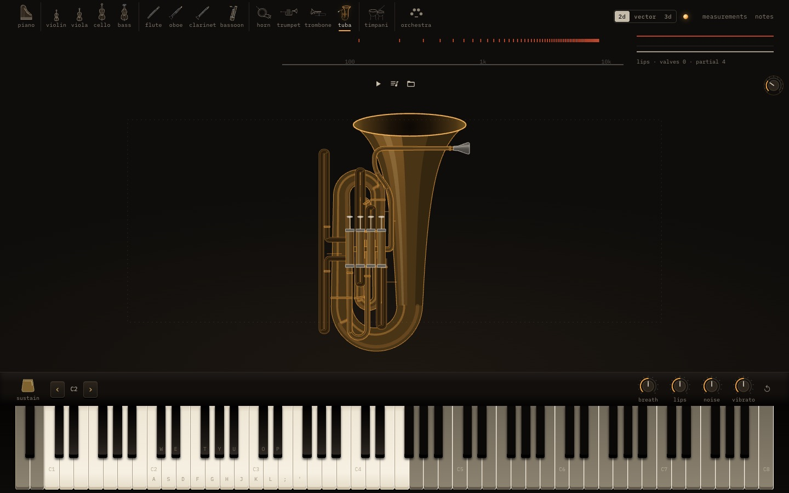 |
| 2D, D♭1 (all four valves) | 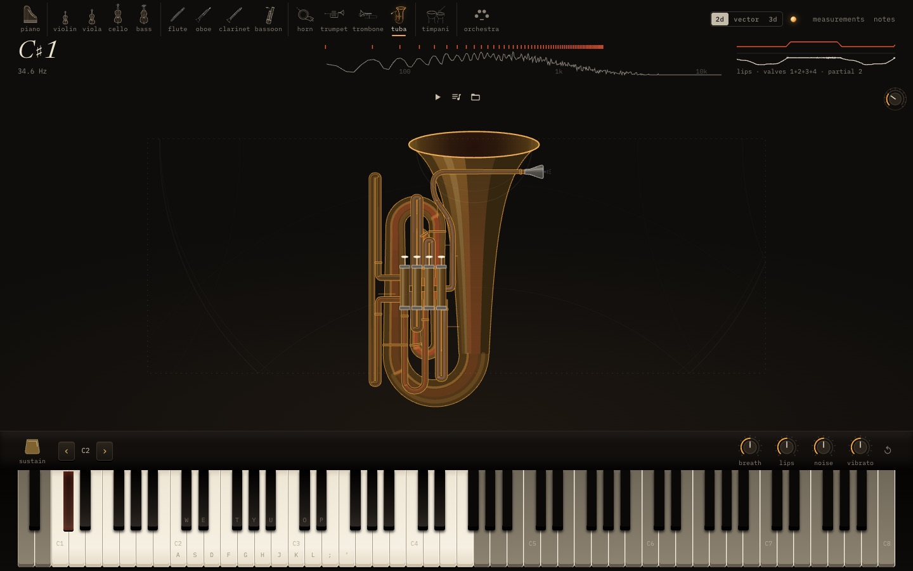 |
| vector, D♭1 | 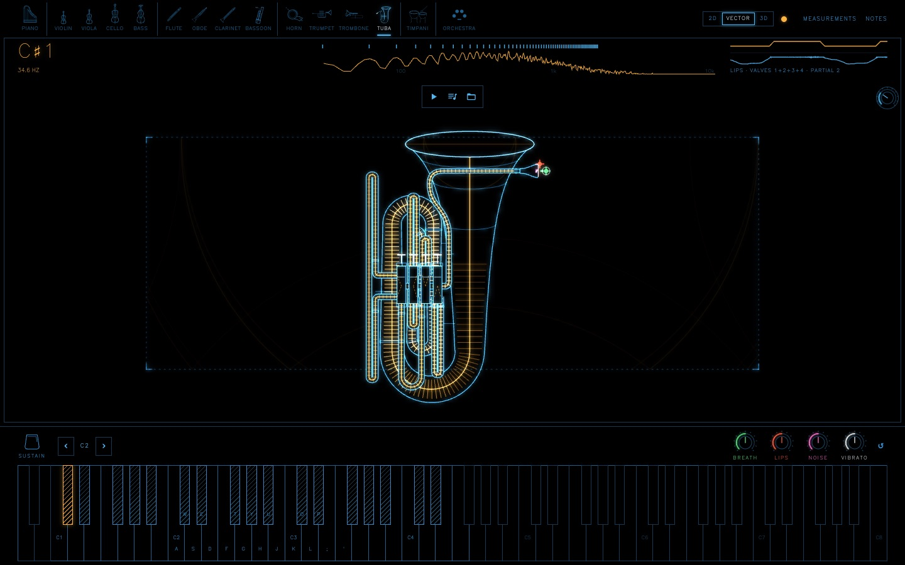 |
| 3D at rest | 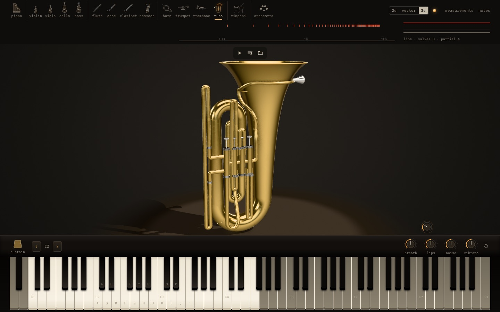 |
| 3D, D♭1 | 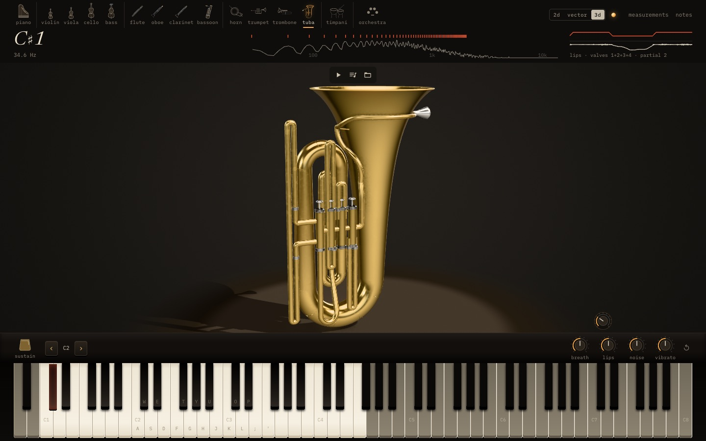 |
| a phone, 2D and 3D | 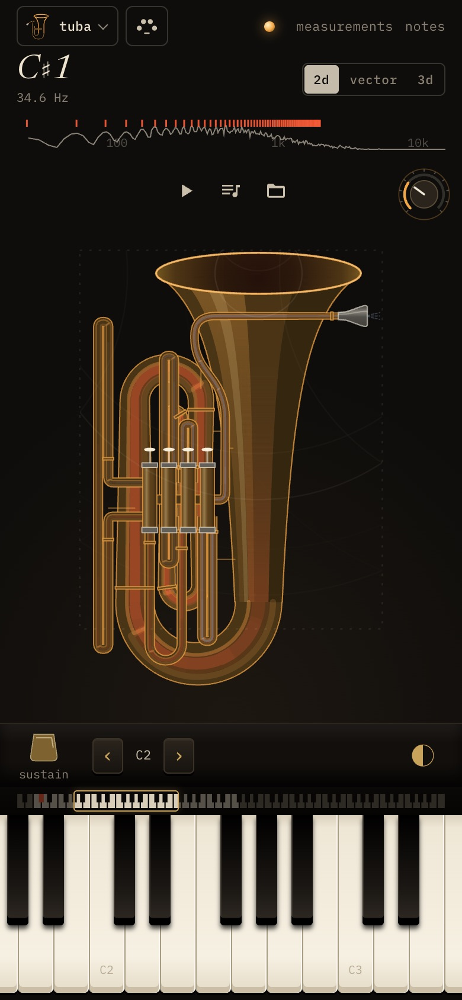 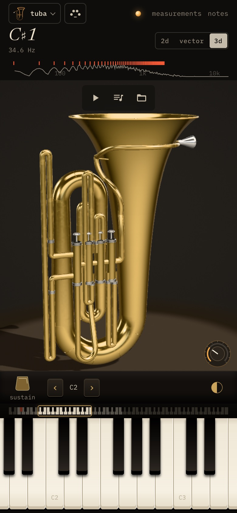 |
| the Orchestra, 2D and 3D (the brass row's right end) | 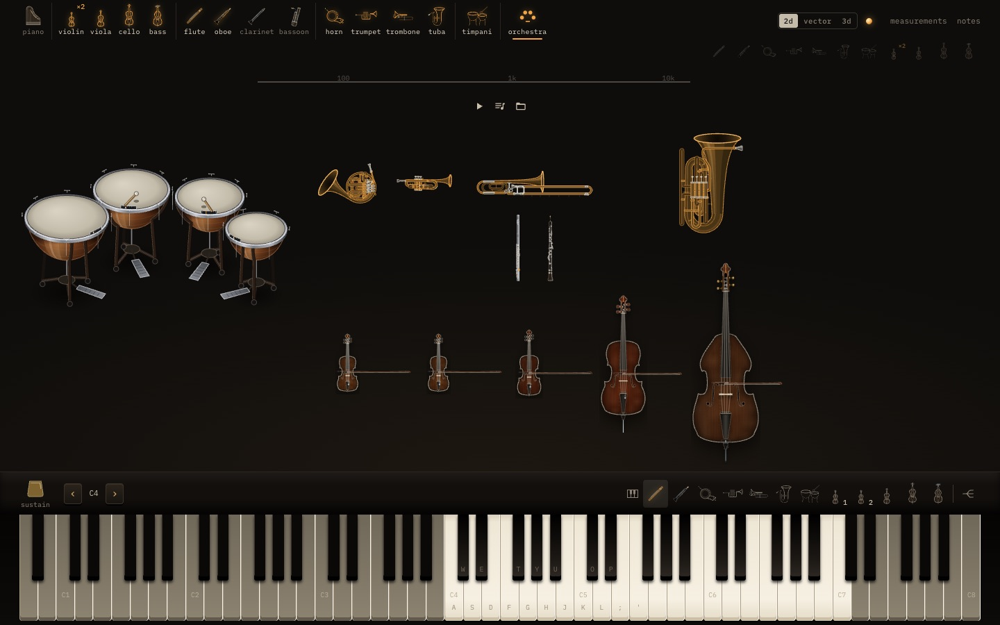 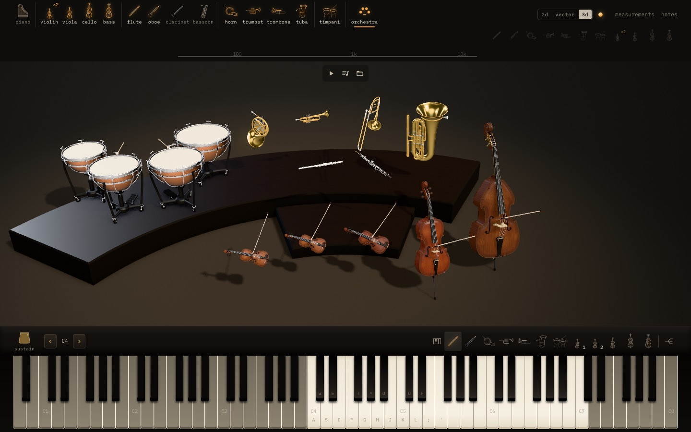 |

Before this PR there was no tuba: a "Tuba" track went to the double bass and program 58 to nothing.

## Routing

* Names: tuba, Tuben, bass and contrabass tuba, Tba., Tb., sousaphone, helicon, bombardon, ophicleide,
  cimbasso, euphonium, tenor tuba → the tuba; the Wagner tuba → the horn. Program byte 58 → the tuba.
* A brass line the file names for no instrument (a "Brass" or "Low Brass" track, a brass program alone) that
  lies clearly under the trombone (its middle below E2 and its core reaching under C2) is the tuba's. A line
  named for the trombone or the trumpet stays theirs however low.
* A lineup picked by hand: the tuba's own line leads the tuba. It sits at the brass row's right end.
* Files without a tuba part route as they did (`apps/web/test/tuba-routing.test.ts`, `e2e/tuba.spec.ts`).
  What changed for existing files: a track named "Tuba" used to go to the double bass.

## The players picker (Stephen's addendum)

The sheet (a phone, a narrow window) was four columns with the piano alone in its first row beside the
grand/upright toggle. Now every row is a kind and four to a row: what is struck or plucked (the piano, the
timpani; the harp and the glockenspiel will complete it), the strings, the woodwinds, the brass. The piano's
kind is out of the grid: with the view switch in the bar wherever the bar has room (wider than 900 px, as it
already was on wide windows), and on a phone at the sheet's foot under a hairline, shown only while a piano
is on the stage.

| before (production) | after | after, a piano on the stage | 1280 px |
|---|---|---|---|
| 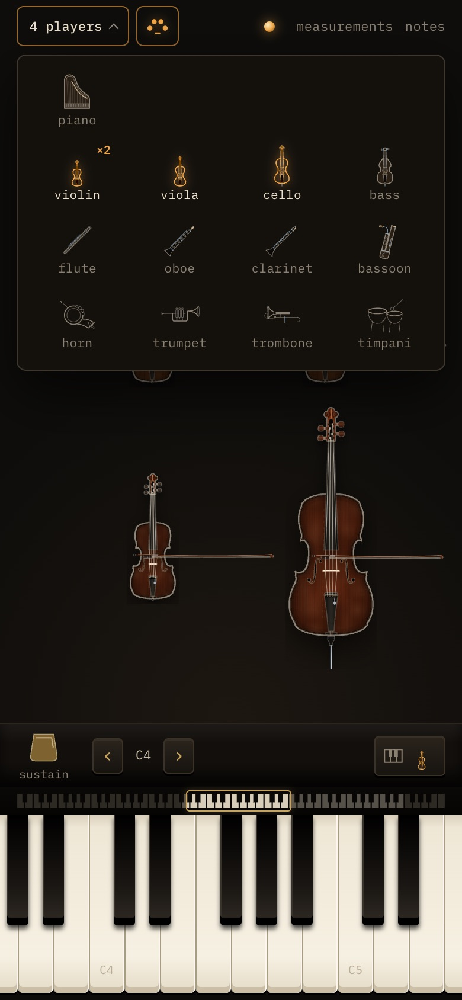 | 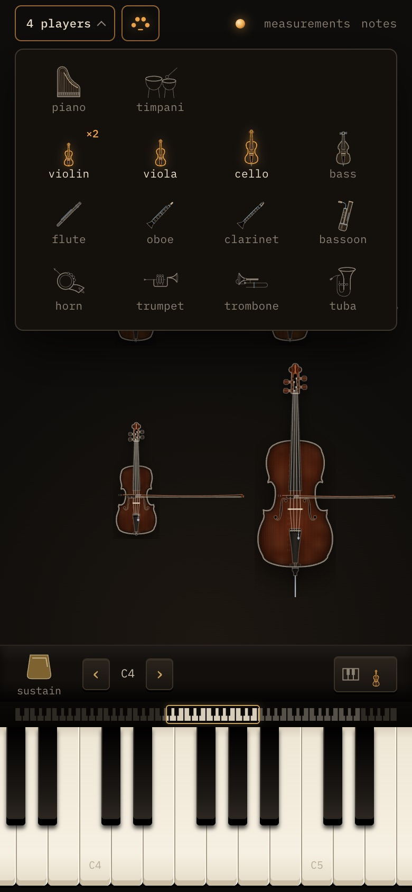 | 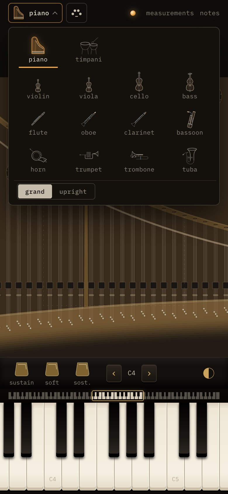 | 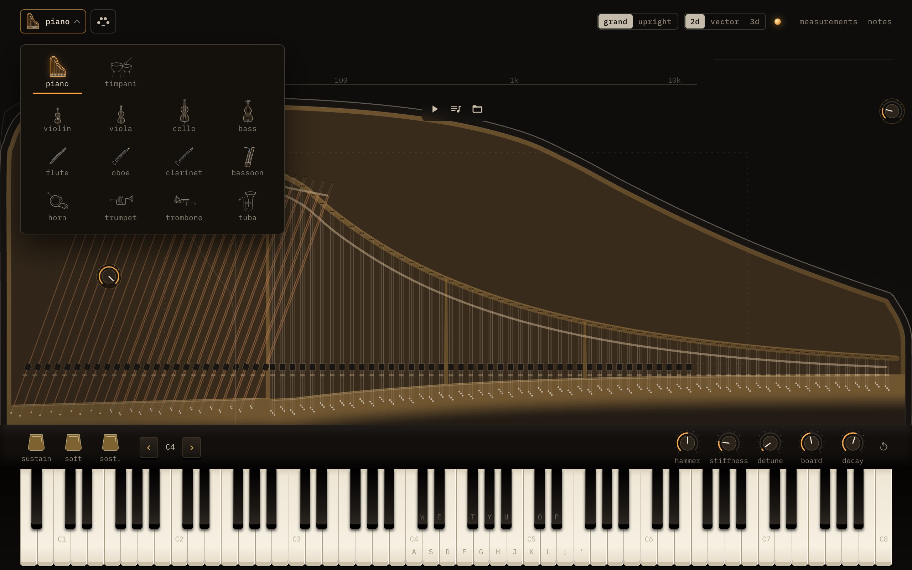 |

## Not in this PR

No audio is committed (the task's rule for these three PRs): the before/after clips and the production
sample are kept outside the repository.
