# A sweep of the whole app's looks

14 Nov 2026. Every instrument, look, window, menu and page was photographed first
(`scripts/shots-inventory.mjs`: about 420 pictures of `main`), read as contact sheets and then one by one
where something looked out of line, and what was out of line with the rest was fixed. No sound was touched.
The pictures here are before | after, from the same script on the two builds.

```
BASE=<url> OUT=<dir> node scripts/shots-inventory.mjs      # SETS=solo,orchestra,ui,pages,windows  DEVS=desktop,phone  ONLY=<part of a name>
```

It writes each shot's page errors, console errors (WebGL's among them), what stands past the window's edge
and whether the page scrolls sideways to `<dir>/report*.json`. On `main` it found none of the first two, and
the one sideways scroll below.

## What was found and fixed

**1. In 2D an orchestra with a piano was drawn at 0.4 of the scale of one without.** The piano took a band
across the whole stage under the others (its plan is as wide as its keyboard), which left an orchestra's rows
54 % of the height: Pass It On's sixteen stood in a fifth of a 1440 px stage's width, a violin 30 px long,
over a piano 1440 px wide. Toward Morning's thirteen, with no piano, are drawn at 137 px/m on that stage;
Everything So Far was at 59, Pass It On at 55, After You the same way. Now, on a wide stage, the piano stands
at the orchestra's left, a third of the width, where the 3D stage already seats an orchestra's keyboards, and
the rows have the rest of the stage at its full height (`ensemble-draw.ts` `SIDE_WIDE`): Pass It On 103 px/m,
Everything So Far 116, After You 137, the Brandenburg's six 225 (they were at 147). A phone held upright, a tablet, and a few players with a piano (a duo, a trio, a
quartet with piano) keep the band: there the piano's strings still stand over the keys that play them.

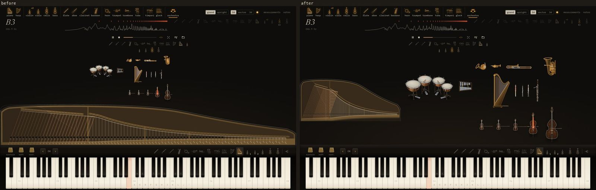
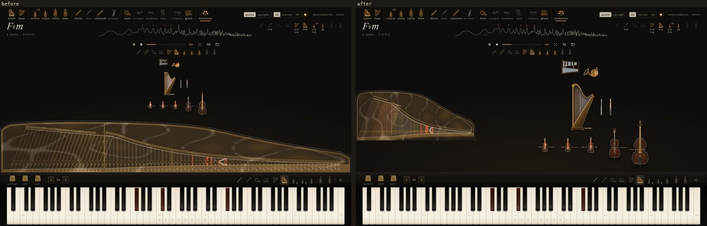
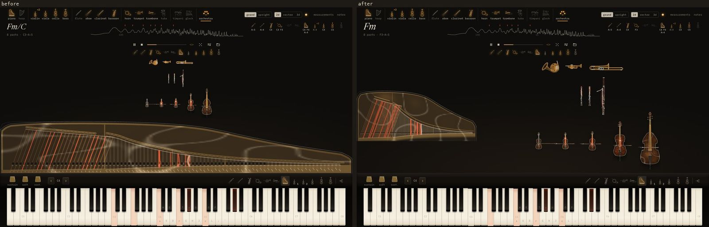
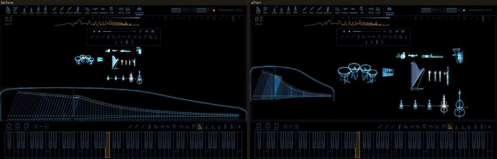

**2. A long lineup ran off a window between a phone's and a computer's.** At 768 px (a tablet held upright,
a narrow window) the strip of an orchestra's instruments in the band was cut off at the window's edge (nine
of Pass It On's sixteen showed), and its row on the fallboard (what the keys play) ran 200 px past the
window, so the page scrolled sideways. Both now give way: each instrument its share of the room there is (a
chip of the keys' row no narrower than 22 px), at their full size wherever they fit.

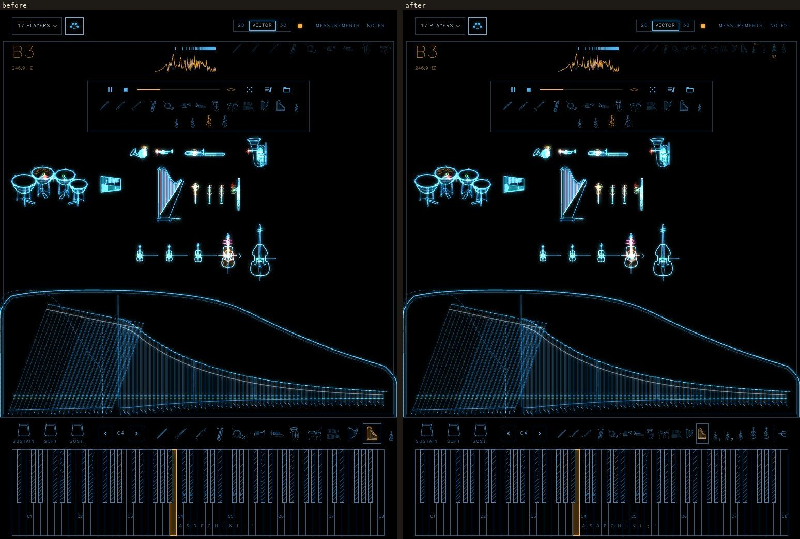
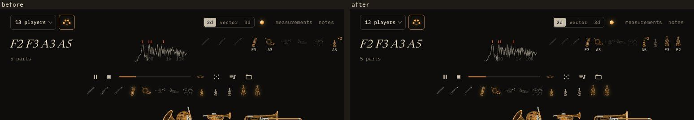

**3. The timpani were seen from opposite sides in 2D and 3D.** The 2D set is drawn from behind the player
(the 32″ at the left, low to high like the keys under it, the pedals and gauges towards us); the 3D stage
first showed it from the hall, the other way round, so a change of view put the drum just struck on the other
side of the stage. The 3D stage now opens on the 2D picture's side, from behind the player and above. In the
Orchestra the hall still sees the set from the hall.

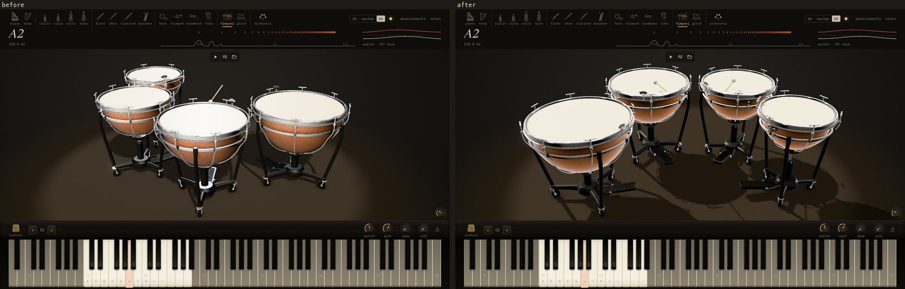
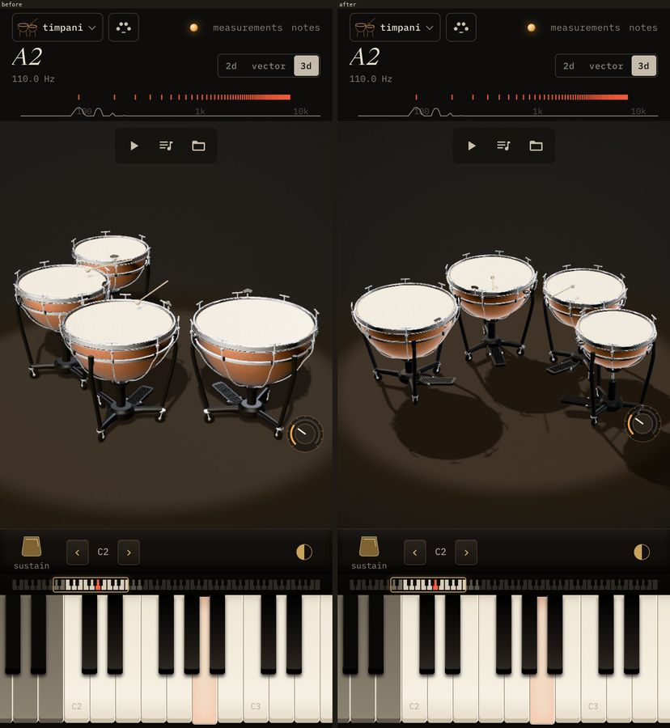

**4. “tap a key” on pages with no keys.** Measurements and Notes showed the stage's hint beside the lamp.
They show the lamp alone now.

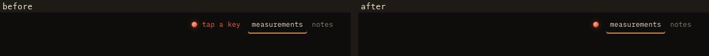

**5. A phone's knob drawer left the reset arrow alone on a second row** where an instrument has six knobs
(the trombone). The six and the arrow share the row.

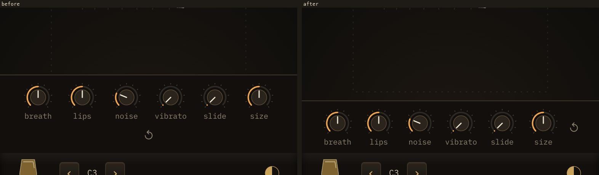

**6. The page's own words were three instruments behind.** The description a search or a link preview shows
said “Thirteen … piano, strings, winds, brass and timpani”, and the Notes page began “Fourteen acoustic
instruments”, with no harp and no glockenspiel. Both say sixteen and name them; a test counts the picker's
instruments against the words.

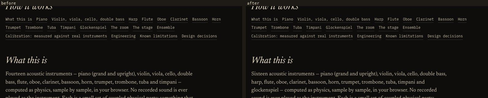

**7. The 404 page had the harp among the bowed strings.** The picker keeps it beside the piano (what is
struck or plucked). The 404 page's families are the picker's now.

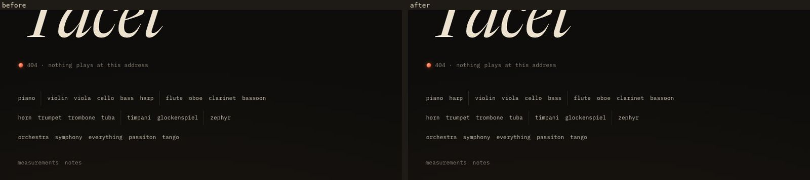

**8. A follow-up (Stephen, the same day): the piano beside an orchestra had no keys.** With the piano at the
orchestra's left (1 above) its strings stand away from the keys on the screen, and strings with no keyboard
are half an instrument. That piano is now drawn with its own 88 keys under its strings, at the plan's key
pitch, a held key lit as the screen's keys are, in 2D and in vector lines. In its band across the stage (a
phone, a tablet, a few players with a piano) it is over the screen's keys and has none, as the piano alone.

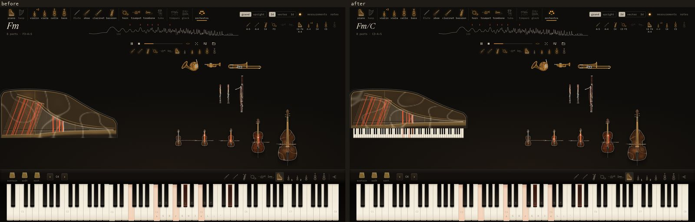
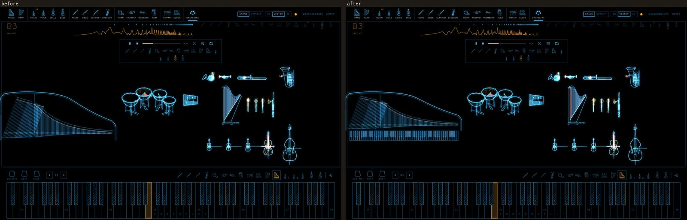

## Looked at and left

* The three looks of each instrument agree on which way round it is (but for the timpani, above), and each is
  whole on every stage photographed, a phone's included.
* A phone held on its side with an orchestra of seventeen is small everywhere (the file's lines, the rows, the
  piano's band in a stage 130 px tall). Nothing is cut; it was left.
* A phone held upright keeps the piano's band under an orchestra: beside it there is no room.
* The pieces menu's small brass glyphs (four trombones in a row) are faint on a screen of one px per CSS px,
  clear on a phone's. Left: the glyphs are the picker's.
